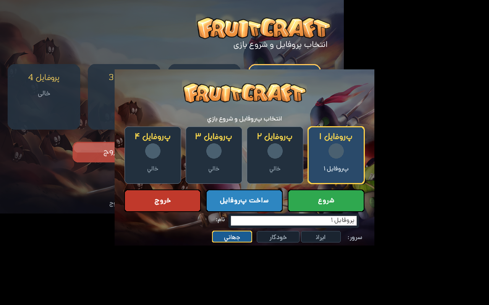
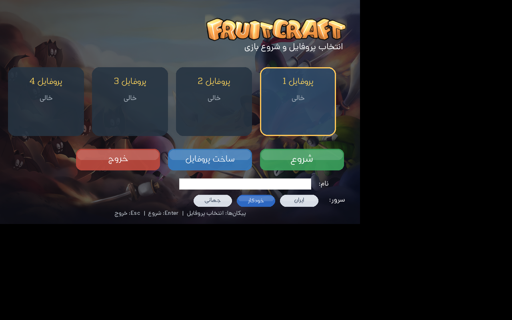
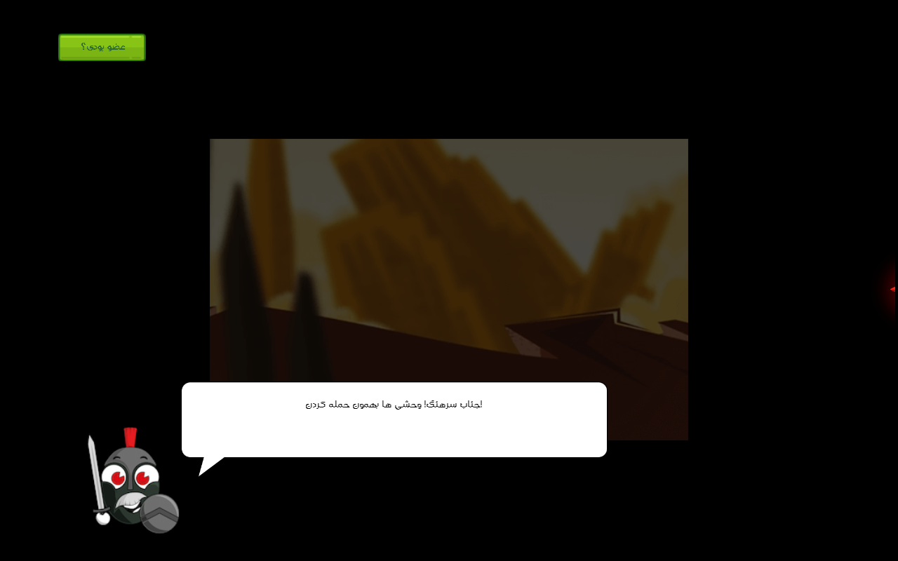

# Fruitcraft PC

Portable **Windows** and **Linux** builds of **Fruitcraft** v1.10.10760, rebuilt
from the official APK (MD5 `37780547e4172a1905a5abbfcdea0f04`) on the official
open-source **Solar2D / Corona SDK** runtime (2026.3738) — the engine the
developers themselves ship on Windows.

> Personal, non-commercial port for testing. The game and all its content are
> © TOD Studio — see [NOTICE.md](NOTICE.md).
> Runtime licence: [LICENSE-Solar2D.txt](LICENSE-Solar2D.txt).

## ⬇ Download (latest: v0.1.13)

| Platform | File | What it is |
|---|---|---|
| **Windows 10/11 (64-bit)** | [fruitcraft-v0.1.13-windows.zip](https://github.com/zhufyer/fruitcraft-pc/releases/download/v0.1.13/fruitcraft-v0.1.13-windows.zip) | `Fruitcraft.exe` launcher + Solar2D 2026 runtime. Extract, double-click, play. |
| **Linux** | [fruitcraft-v0.1.13-linux.zip](https://github.com/zhufyer/fruitcraft-pc/releases/download/v0.1.13/fruitcraft-v0.1.13-linux.zip) | Native launcher (Python + Tk), game runs through your system **Wine**. |

All releases: [Releases page](https://github.com/zhufyer/fruitcraft-pc/releases).

## 🌍 Which server? — choose it in the launcher

The game has two hosts: **`iran.fruitcraft.ir`** and **`global.fruitcraft.co`**.
Older builds guessed which one to use from the computer's **timezone**, which is
why a laptop abroad (or behind a VPN) asked the Iranian host and then sat in the
loading scene forever — the black, *Not Responding* window.

Since **v0.1.13** you pick the server in the launcher itself, on the **سرور:**
row at the bottom of the window:

| Button | Sends | Use it when |
|---|---|---|
| **ایران** | `FRUITCRAFT_SERVER=mycountry` | you are in Iran, no VPN |
| **خودکار** (default) | probes both hosts, prefers the global one | you do not want to think about it |
| **جهانی** | `FRUITCRAFT_SERVER=global` | you are outside Iran or using a VPN |

The choice is remembered (`%APPDATA%\Fruitcraft\server.txt`, Linux:
`~/.config/fruitcraft/server.txt`) and handed to the game as an environment
variable, so nothing has to be edited by hand. Some text of the game comes from
the global server in English; that is expected.

If the window ever stays black anyway, send these two files from the folder
next to `Fruitcraft.exe`:

| File | Written by |
|---|---|
| `fruitcraft.log` | the launcher (server choice, probes, engine pid, exit code) |
| `fruitcraft-engine.log` | the game bootstrap (`player/load` results, runtime errors, stage watchdog) |

## Run — Windows

1. Extract the zip anywhere you can write.
2. Double-click `game/Fruitcraft.exe`.
3. The launcher window opens, drawn with the game's own art:
   four profiles (RTL, profile 1 right-most), **شروع / ساخت پروفایل / خروج**,
   a name field, and the **سرور:** row (ایران / خودکار / جهانی).
   Press **شروع** (or Enter) and the game starts in landscape.

Per-profile data: `%APPDATA%\Fruitcraft\profiles\pN`. Logs next to the exe:
`fruitcraft.log` (launcher) and `fruitcraft-engine.log` (game).

## Screenshots

| Launcher v0.1.13, Windows — with the سرور: row | Linux launcher — same row |
|---|---|
|  |  |

| In game (global server), Persian, landscape |
|---|
|  |

## Run — Linux

```bash
sudo apt install python3 python3-pil python3-tk wine64 xdotool   # Debian/Ubuntu
# Fedora: sudo dnf install python3-pillow python3-tkinter wine xdotool
chmod +x Fruitcraft && ./Fruitcraft
```

The launcher looks and behaves exactly like the Windows one (same RTL layout,
same in-game assets, same **سرور:** row). The game itself runs on the bundled Solar2D 2026 runtime
through Wine; each profile gets its own Wine prefix under
`~/.local/share/Fruitcraft/profiles/pN`. First run of a profile prepares the
prefix (1–3 min, shown in the launcher), later runs are fast.

Verified end-to-end on Wine 11.22 (staging, wow64) + Mesa llvmpipe on a plain X
server: launcher → شروع → 960×640 landscape splash with the Persian logo →
the game's loading scene. Persian text renders correctly inside Wine without any
font configuration.

## Layout

```
game/
├── Fruitcraft.exe            launcher (Rust, source in launcher-rust/)
├── engine/                   Solar2D 2026.3738
│   ├── Corona.Shell.exe      64-bit runtime (Corona Labs)
│   ├── CoronaLabs.Corona.Native.dll, lua.dll, ALmixer, mfx/vcrun, …
│   └── plugin_*.lua          safe no-op stubs for the mobile plugins
├── FruitcraftEngine.exe      original mobile engine (fallback only)
└── data/
    ├── main.lua              bootstrap: runs the game's own bytecode
    ├── config.lua            desktop content 960×640 (no orientation key)
    ├── build.settings        window: maximized, title "Fruitcraft"
    ├── config.lu             the game's own settings chunk (locale/market)
    ├── plugin/               plugin stubs (ads / analytics / IAP / notifications)
    └── assets…               Assets-SD, fonts (FA/EN), spine, Json, …
```

The game logic is the developers' original Lua bytecode, unmodified, running on
the official engine — no decompiled source is executed.

## What this project adds

| Part | Where |
|---|---|
| Windows launcher (Win32, Rust, game's own art + RTL Persian) | `launcher-rust/main.rs` |
| Linux launcher (Python 3 + Tkinter + Pillow) | `linux/fruitcraft.py` |
| Persian UI labels shaped with HarfBuzz at build time | `linux/tools/make_labels.py` → `linux/launcher/labels/` |
| Lua 5.1 desktop bootstrap + plugin preloads | `game/data/main.lua` |
| Landscape desktop content settings | `game/data/config.lua`, `build.settings` |
| Native-plugin stubs | `game/data/plugin/`, `game/engine/plugin_*.lua` |

## Fixed engine/desktop bugs (all proven by real runs)

* old mobile engine → **"scenegraph start lu"** crash → replaced by Solar2D 2026.
* `f:read("a")` (Lua 5.2 syntax) → `read("*a")`.
* `load(string)` → `loadstring` (the engine is Lua 5.1).
* plugin stubs written as `{{ }}` (invalid Lua) → real stubs, so
  `require "plugin.notifications.v2"` no longer returns nil
  (`cancelNotification` crash).
* `resource.car` removed — the archive carried its own 320×480 SDK config and
  overrode every window setting (portrait window).
* `config.lu` runs again (it defines `_serverType`, `_profanityList`, metadata)
  and the landscape content block is re-applied afterwards.
* Game language forced to its native Persian data set (`_mainLang = "fa"`),
  instead of being derived from the OS timezone.
* Window: no `orientation` key on purpose — with one, the desktop shell picks a
  portrait device profile; without it the window follows the 960×640 content.
  The launcher also verifies the window really grew (1288×808 in the test run).

## Notes

* Ads / IAP / analytics are disabled (mobile-only, plus safe stubs).
* Online features (battle / leaderboard / tribe) need internet; the game shows
  its own "Load Failed" dialog when offline.
* The repo holds sources and screenshots; the zips are release assets only
  (they exceed GitHub's file-size limit for git).
